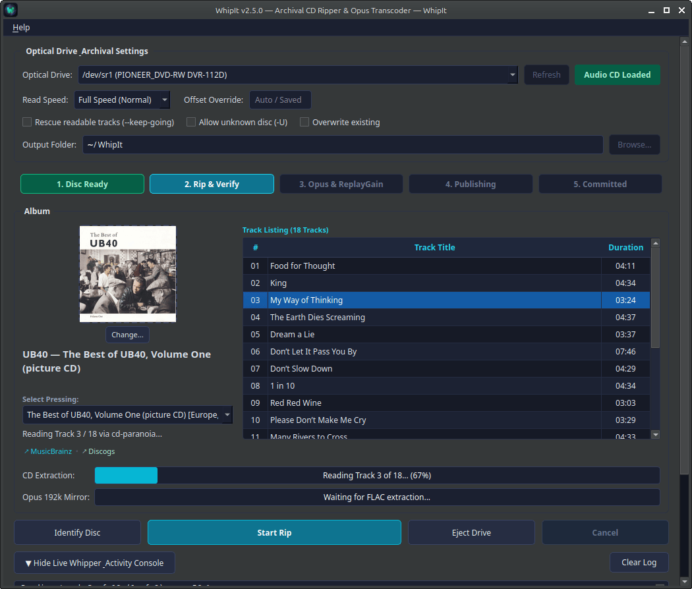

<p align="center">
  
</p>

# WhipIt

> **AccurateRip + MusicBrainz Archival CD Ripper & Opus Transcoder for Linux**

WhipIt is a Linux desktop application built with PyQt6 for ripping Audio CDs into AccurateRip-verified FLAC archives alongside synchronized 192 kbps Opus mirrors for portable devices. It pairs Whipper and cd-paranoia for extraction, matches releases via MusicBrainz, calculates EBU R128 ReplayGain using loudgain, downloads and embeds cover art, and stages outputs in isolated transactions to prevent partial or broken writes.

<p align="center">
  
</p>

## Features

- **Accurate two-pass extraction**: Drives Whipper and cd-paranoia with drive sample offsets and C2 error recovery. Each track is read and verified in two passes to guarantee sample-accurate audio.
- **AccurateRip verification**: Validates ripped tracks against the online AccurateRip database and verifies FLAC stream integrity with `flac -t -s`.
- **Dual output formats**: Creates a bit-perfect FLAC archive (including CUE sheet, log, and embedded artwork) alongside a 192 kbps VBR Opus mirror for phones and portable players.
- **MusicBrainz release matching**: Queries MusicBrainz by disc ID. When multiple pressings exist, an edition dropdown lets you choose the exact release (displaying country, year, and catalog numbers).
- **Cover art handling**: Retrieves full-resolution front cover art from the Cover Art Archive, generates scaled images for tag embedding to prevent file bloat, and lets you drag or select custom artwork.
- **ReplayGain volume leveling**: Applies track and album EBU R128 loudness tags across both FLAC and Opus files using `loudgain`.
- **Desktop automount suppression**: Silences file manager popups and automount dialogs during rips on GNOME, XFCE (`thunar-volman`), MATE, and Cinnamon.
- **Live speed monitoring**: Displays detected drive speed limits (e.g. `[Max 48x]`), real-time extraction speed (`@ 8.4x`), and final average throughput.
- **Transactional staging**: Extracts and transcodes into an isolated staging directory (`.whipit-stage.<job-id>`) before publishing. If an error occurs or a rip is cancelled, the staging area is rolled back cleanly.
- **Crash recovery**: Unfinished or interrupted rips are detected on startup, giving you the choice to resume publishing or safely discard staging files.
- **Custom Metadata & Smart Tracklist Import**: Users can open the metadata editor to customize artist, album, year, and genre, or paste a raw tracklist copied from Bandcamp, Wikipedia, or Discogs (WhipIt automatically strips leading track numbers, timestamps, and quotes).
- **MusicBrainz Submission Helper**: For uncataloged discs, the GUI displays an *Add this Disc to MusicBrainz* link with the disc's TOC pre-filled, plus a *Copy Submission Note* button that formats a ready-to-paste edit note (containing drive model, TOC timings, and track count).
- **Discogs Cross-Reference**: When a MusicBrainz release matches, WhipIt automatically looks up and links the matching Discogs release.
- **Cryptographically Verified Updates**: The application includes an in-app updater under **Help → Check for Updates...** that verifies release wheels against a bundled GPG keyring.
- **Screen & System Sleep Inhibit**: During active rips, WhipIt inhibits system idle and suspend over D-Bus (`org.freedesktop.PowerManagement` and `ScreenSaver`) so long extractions aren't interrupted by system sleep.

## System Requirements & Dependencies

WhipIt runs on **Linux** with **Python 3.9+** and standard audio CLI utilities.

### Debian / Ubuntu / Linux Mint
```bash
sudo apt update && sudo apt install -y whipper flac opus-tools loudgain eject libnotify-bin python3-venv unzip
```

### Fedora
```bash
sudo dnf install -y whipper flac opus-tools eject libnotify python3-virtualenv unzip
```

### Arch Linux / Manjaro
```bash
sudo pacman -S --needed whipper flac opus-tools eject libnotify unzip
```
> *Note: `loudgain` can be installed from the AUR (`yay -S loudgain` or `paru -S loudgain`).*

## Installation

For standard use, download and run the installer from the latest release:

1. Download the latest release `.zip` archive from the [Releases Page](https://github.com/mathewcallaghan/WhipIt/releases).
2. Extract the archive and enter the folder:
   ```bash
   unzip whipit-*.zip
   cd whipit-*
   ```
3. Run the installer script:
   ```bash
   chmod +x install.sh
   ./install.sh
   ```

The installer will:
- Set up an isolated Python virtual environment in `~/.local/share/whipit/venv` with hash-checked, pinned dependencies.
- Symlink the application launcher to `~/.local/bin/whipit`.
- Install the application icon and desktop launcher menu entry (`whipit.desktop`).

> **Tip:** If running `whipit` in your terminal says `command not found`, ensure `~/.local/bin` is in your `$PATH` by adding `export PATH="$HOME/.local/bin:$PATH"` to your `~/.bashrc` or `~/.zshrc`.

## Development
Clone the repository and run the installer:

```bash
git clone https://github.com/mathewcallaghan/WhipIt.git
cd WhipIt
chmod +x install.sh
./install.sh
```

### Developer Mode (Editable Install)
To develop locally so changes reflect immediately without reinstalling:
```bash
./install.sh -e
```

The installer will:
1. Create an isolated virtual environment in `~/.local/share/whipit/venv` with hash-checked dependencies (`PyQt6`, `pydantic`).
2. Symlink the application launcher to `~/.local/bin/whipit`.
3. Install the application icon and desktop launcher entry (`whipit.desktop`).

## Using WhipIt

Launch WhipIt from your application menu or run `whipit` in your terminal.

- **Drive & Disc Detection**: Detects SATA and external USB optical drives, showing the drive's rated hardware speed (e.g. `[Max 48x]`) and active disc status (`Audio CD Loaded`, `Enhanced CD`, or `Tray Empty`).
- **Drive Offset Calibration**: AccurateRip verification requires your drive's sample read offset. WhipIt automatically prompts you or allows you to run drive calibration by inserting a popular commercial CD, querying the AccurateRip database, and saving the offset to `~/.config/whipit/offsets`.
- **Disc Identification**: Reads the disc Table of Contents (TOC) on load and queries MusicBrainz for release info, track titles, and lengths before ripping.
- **Pressing Selector**: If multiple editions match the disc ID, select your pressing from the drop down to view its country, release date, catalogue number, and track listing.
- **Cover Art**: Front cover art is retrieved from the Cover Art Archive automatically. Click the artwork preview or "Change..." to select a local image (`.jpg`, `.png`).
- **Extraction Options**:
  - **Read Speed**: Select an upper speed limit (`8x (Recommended)`, `4x (Safe / Scratched)`, `Full Speed (Maximum)`, `12x`, `16x`, `24x`).
  - **Offset Override**: Manually override drive sample offsets (or rely on auto-calibrated values).
  - **Rescue readable tracks (`--keep-going`)**: Continues ripping readable tracks when encountering scratched discs.
  - **Allow unknown disc (`-U`)**: Rips uncatalogued discs or CD-Rs with generic track tags.
  - **Overwrite existing**: Safely replaces an earlier rip of the same album while preserving a backup during the transaction.
- **Progress & Speed Tracking**: Follows real-time progress across extraction, two-pass verification, Opus transcoding, and ReplayGain tagging, showing instantaneous throughput (`@ 8.4x`) and overall average speed upon completion.
- **Live Activity Console**: Collapsible log window showing raw output from Whipper and cd-paranoia.
- **Disc Identification**: Reads disc Table of Contents (TOC) on load and queries MusicBrainz for release info, track titles, and lengths before ripping. If matched, it also links directly to the corresponding Discogs release.
- **Uncatalogued Discs & Submission Assistant**: For uncatalogued discs, click **Add this Disc to MusicBrainz** to attach the disc TOC, or use **Copy Submission Note** to copy a pre-formatted edit note with drive model, track counts, and timings directly to your clipboard.
- **Custom Metadata & Clipboard Import**: Click **Edit Metadata...** to manually adjust artist, album, year, or track titles. You can also paste raw tracklists from Bandcamp, Wikipedia, or text files—durations and track numbers are parsed and cleaned automatically.
- **Pressing Selector**: If multiple editions match the disc ID, select your pressing from the drop down to view its country, release date, catalogue number, and track listing.
- **In-App Updates**: Check for and install signed releases directly from **Help → Check for Updates...** (cryptographically verified against official release keys).

### Command-Line Usage

```bash
whipit [OPTIONS]

Options:
  -d, --device PATH      Specify CD-ROM drive path (e.g. /dev/sr0)
  -o, --output-dir PATH  Override destination directory
  --calibrate-drive      Run the drive read offset calibration wizard
  -v, --version          Show application version
  --help                 Show all available options
```

## Output Directory Structure

By default, files are saved to `~/WhipIt` (configurable in the UI or via `WHIPIT_OUTPUT_DIR`).

### Single-Disc Album
```
~/WhipIt/Artist - Album Title/
├── Artist - Album Title (FLAC)/
│   ├── 01. First Track.flac
│   ├── 02. Second Track.flac
│   ├── cover.jpg
│   ├── Artist - Album Title.cue
│   └── Artist - Album Title.log
└── Artist - Album Title (Opus)/
    ├── 01. First Track.opus
    ├── 02. Second Track.opus
    └── cover.jpg
```

### Multi-Disc Sets
```
~/WhipIt/Artist - Album Title/
├── Artist - Album Title (FLAC)/
│   ├── Disc 1/
│   │   ├── 01. Track One.flac
│   │   ├── cover.jpg
│   │   └── Artist - Album Title (Disc 1).cue
│   └── Disc 2/
│       ├── 01. Track One.flac
│       └── cover.jpg
└── Artist - Album Title (Opus)/
    ├── Disc 1/
    └── Disc 2/
```

## Configuration & Data Paths

WhipIt adheres to the XDG Base Directory specification:

| Path | Purpose |
| :--- | :--- |
| `~/.config/whipit/offsets` | Stored AccurateRip drive read offsets |
| `~/.local/state/whipit/jobs/` | JSON transaction manifests for active and recoverable jobs |
| `~/.local/state/whipit/` | Session execution logs and error logs |
| `~/.cache/whipit/` | Temporary extraction staging and cd-paranoia WAV cache |
| `~/.cache/whipit/covers/` | Cached Cover Art Archive downloads |
| `~/.local/share/applications/whipit.desktop` | Desktop launcher menu entry |
| `~/.local/share/icons/hicolor/scalable/apps/whipit.svg` | Application icon |

### Environment Variables

| Variable | Default | Purpose |
| :--- | :--- | :--- |
| `WHIPIT_OUTPUT_DIR` | `~/WhipIt` | Default destination directory for FLAC and Opus outputs |
| `WHIPIT_LOG_LEVEL` | `INFO` | Logging verbosity (`DEBUG`, `INFO`, `WARNING`, `ERROR`) |
| `WHIPIT_DRIVE` | *(Auto-detected)* | Path to optical device node (e.g. `/dev/cdrom` or `/dev/sr0`) |

## Uninstallation

To remove WhipIt, its desktop launcher, and command links:
```bash
./uninstall.sh
```

To purge all configuration files, saved offsets, and logs as well:
```bash
./uninstall.sh --purge
```

## Testing

Install test dependencies into the application venv and run the suite:
```bash
~/.local/share/whipit/venv/bin/pip install pytest
~/.local/share/whipit/venv/bin/pytest -v
```

Run tests directly using WhipIt's installed application venv:
```bash
~/.local/share/whipit/venv/bin/pytest -v
```

## License & Acknowledgments

WhipIt is released under the GNU General Public License v3.0 (GPL-3.0).

Built on top of:
- **Whipper** & **cd-paranoia** for robust audio extraction and AccurateRip verification.
- **MusicBrainz** & the **Cover Art Archive** for release metadata and artwork lookup.
- **loudgain** for EBU R128 ReplayGain calculation.
- **PyQt6** for the Linux desktop user interface.
